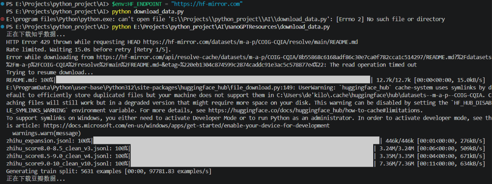
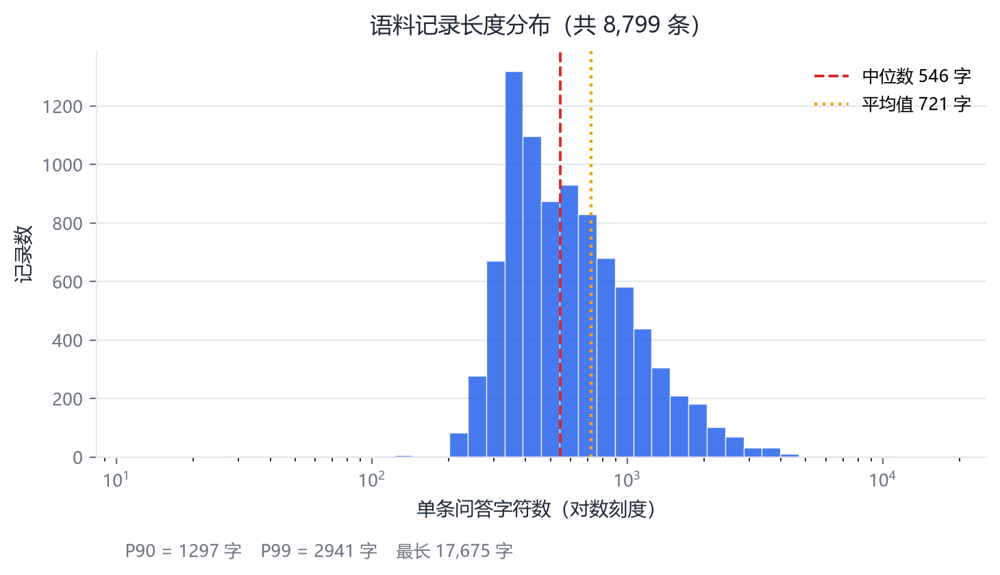
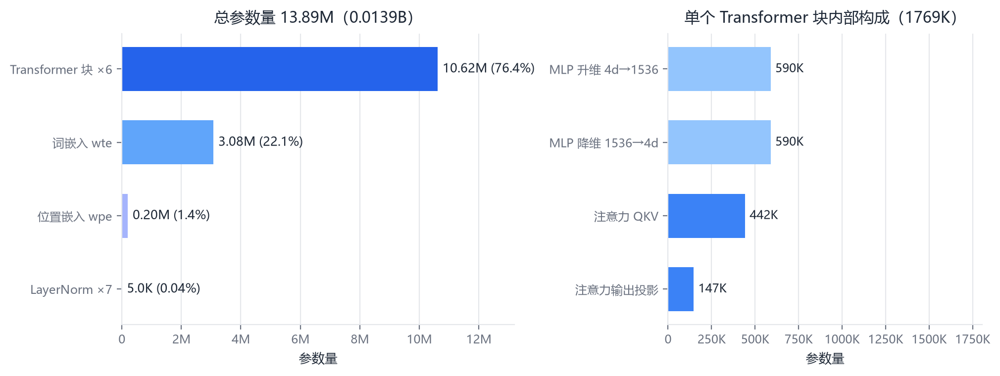
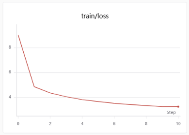
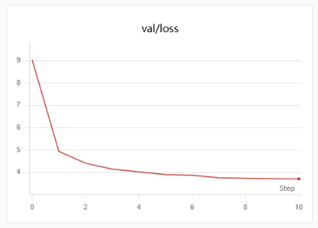
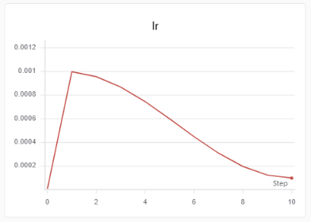

# 基于 nanoGPT 的中文小模型从零预训练

> 课程作业 · 数据构建 → 训练 → 评估全流程复现　|　2026 年 11 月

## 摘要

以 COIG-CQIA 数据集的知乎、豆瓣子集为语料，整理出 8,799 条问答、636 万字符，采用**字符级分词**构建 8,010 词表，用 Karpathy 的 nanoGPT 在单张 Tesla V100-32GB 上训练了一个 6 层、384 维、**13.89M 参数**的 GPT 结构模型。共训练 1,500 步（约 15.5 个 epoch、9,830 万 token），验证集 loss 从随机基线 8.99 降至 **3.71**（下降 58.8%），字符级困惑度 **40.7**。

实验还得到一个反直觉的结论：**该数据规模下算力并非瓶颈**——完整训练仅需 5.3 分钟，2 小时窗口存在近 20 倍冗余。这个测量结果直接改变了模型规模的选型逻辑。

## 1. 方案设计

| 项目 | 配置 |
|---|---|
| 训练硬件 | Tesla V100-32GB 单卡，Ubuntu 22.04 + CUDA 12.4，单次开机限 2 小时 |
| 本地环境 | R5-5800H + RX 6600M，仅用于数据预处理（AMD 显卡训练环境配置成本过高） |
| 模型代码 | nanoGPT 官方原版（约 300 行，无框架封装，全流程可逐行追溯） |
| 混合精度 | FP16 + GradScaler（V100 不支持 BF16） |
| 日志后端 | SwanLab（WandB 国内不可访问，改用国产平替） |

**为什么改用字符级分词。** nanoGPT 默认用 GPT-2 的 BPE 分词器（50,257 词表），对中文有两个问题：一是压缩率差，500 余万汉字会被切成 900 万–1,200 万 token，训练量凭空翻倍；二是 tiktoken 首次运行需从 OpenAI 对象存储下载词表，网络不稳时会失败。改用字符级后词表降至 **8,010**，token 数与字符数一一对应，且全程无需联网。nanoGPT 原生支持该模式：`train.py` 检测到数据目录下的 `meta.pkl` 便会自动采用其中词表，无需改代码。

## 2. 数据集构建

**来源与流程。** COIG-CQIA 的 `zhihu`、`douban` 两个子集，按 `instruction` / `output` 字段拼接为统一格式后合并：

```
下载 zhihu / douban 子集
    ↓  拼接为「问题：xxx\n回答：xxx\n\n」，保留问答标记以让模型学到对话结构
    ↓  合并为 zhihu_douban.txt（17.8 MB）
    ↓  按 99.5% / 0.5% 切分，切点对齐换行符，避免从句子中间劈开
    ↓  字符级编码 → train.bin / val.bin / meta.pkl
```



*图 1　数据下载与合并过程（因网络限制经 HF 镜像站下载）*

| 指标 | 数值 |
|---|---|
| 文件大小 / 总字符数 | 17.8 MB / 6,366,690（其中汉字 5,054,020） |
| 记录条数 | 8,799 |
| 单条长度 中位数 / 平均 | 546 / 721 字 |
| 单条长度 P90 / P99 / 最长 | 1,297 / 2,941 / 17,675 字 |
| 词表大小 | 8,010 |
| 训练集 / 验证集 token | 6,334,937 / 31,753 |



*图 2　记录长度分布（横轴对数刻度）。右偏明显：中位数 546 字，长尾拖至近 3,000 字，最长一条 17,675 字。*

长尾成因是知乎存在大量含公式的长篇技术回答，而豆瓣影评普遍简短。这会让固定 `block_size=512` 的样本中，短文本被大量填充、长文本被截断，是后续可优化的点。

## 3. 模型结构

GPT-2 同构的 decoder-only Transformer：`n_layer=6`、`n_head=6`、`n_embd=384`、`block_size=512`、`dropout=0.1`、线性层无 bias，**总参数 13,894,272**。



*图 3　左：总参数量的四个组成部分；右：单个 Transformer 块内部的参数分配。*

两处值得注意：

- **词嵌入占 22.1%**。若用默认的 50,304 词表，仅词嵌入就有 1,930 万参数（占比 65%），14M 的总预算下会把 Transformer 层挤压到无法训练。字符级分词在这里不只是省时间，更是让参数预算合理分配的前提。
- **Transformer 块占 76.4%**，其中 MLP 两层合计占单块的 66.7%，与 GPT 系列"MLP 参数远多于注意力"的结构一致。

## 4. 训练与结果

| 项目 | 取值 |
|---|---|
| 优化器 | AdamW（fused），β₁/β₂ = 0.9 / 0.99，权重衰减 0.1 |
| 学习率 | 峰值 1e-3，预热 100 步后余弦退火至 1e-4 |
| 全局批量 | 32 × 512 token × 4（梯度累积）= 65,536 token/iter |
| 训练步数 | 1,500（98,304,000 token ≈ 15.5 epoch） |
| 实测性能 | 210 ms/iter，约 31.2 万 token/秒，MFU 8.5–9.3%，纯训练 5.3 分钟 |




*图 4　训练集（上）与验证集（下）loss。横轴为 SwanLab 记录的评估点序号，每点间隔 150 步，共 11 个点。*



*图 5　学习率调度：100 步预热至 1e-3，随后余弦退火至 1e-4。*

曲线呈三个阶段：**0–150 步** loss 从 9.04 暴跌至 4.9，模型主要在学字符的边际分布，收益最大；**150–900 步**放缓但持续下降，开始掌握词语搭配与常见句式；**900–1500 步**训练 loss 仍缓慢下行至 3.26，而验证 loss 在 3.65–3.72 之间基本持平，两者差距拉到 0.43，进入轻度过拟合。

| 指标 | 数值 |
|---|---|
| 训练集 / 验证集 loss | 3.2758 / **3.7065** |
| 困惑度 PPL（每字） | 40.71 |
| Bits per character | 5.347 |
| 随机基线 loss = ln(8010) | 8.9884 |
| 相对基线下降 | **58.8%** |

验证 loss 3.71 意味着：给定前文预测下一个字，模型从"在 8,010 个字里瞎猜"优化到"在约 41 个候选字中挑一个"。它掌握了中文的字符级统计规律，但距离理解语义仍有很大距离。需注意验证集仅 31,753 token（约 62 个 block），样本量偏小，验证 loss 的绝对值应留有余量地解读。

## 5. 生成样本分析

**学到的能力。** 一是对话格式完全正确——「问题：」触发提问，换行后「回答：」接续正文，且提问常带"你能帮我写一段……吗？像……那样"的豆瓣体句式；模型生成长文本时甚至**会自发再发一个新的「问题：」**，说明它学到了语料中多轮问答的段落结构，而非单条格式。二是**主题域清晰**：「如何评价」触发的回答围绕书籍、历史、制度，「在豆瓣上」则集中在动画电影简介，两个子集的风格被区分开。三是生成的文本几乎没有生造字或乱码，标点使用基本合规——这对一个仅 13.89M 参数、训练 6 分钟的模型已超出"只学会字频"的预期。

**暴露的问题。** 最典型的是**复读退化**，温度 0.8 时已出现："人类的爱，是在一起，彼此之间都是相互相互的一件事……彼此，彼此相相互相互相处"。一旦进入高频局部模式，模型缺少足够的上下文信号把自己拉出来，这是小数据字符级模型的通病。

其次是**LaTeX 公式泄漏**，语料含大量数学回答，模型学会了输出 `$$...$$` 与反斜杠命令却拆得支离破碎：

```text
回答：2\acd{d}(x)-\phi}(x)-\cdotiv \$, 同时也发生了一个不同的世界。
```

形式对、内容全错，恰好说明字符级建模学的是符号共现而非符号含义。此外还有**数字幻觉**："202022 年"、"100000 万次"——年月日结构正确，但数值完全脱离现实。温度从 0.8 升到 1.0 后多样性上升，语义连贯性则明显恶化。

## 6. 问题与局限

**模型规模未达 0.1B。** 实际参数量 13.89M，约为 0.1B 的 1/7，这是立项时基于"2 小时算力窗口可能不够"的判断做的保守选择。但实测推翻了该前提：该配置跑完 15 个 epoch 只需 5.3 分钟，2 小时窗口可支持 3 万步以上，**算力存在近 20 倍冗余**。限制模型规模的从来不是算力，而是未经测量的假设。若改为 GPT-2 small 同构的 12 层 / 768 维（91.5M），同等窗口内约 30–45 分钟即可完成，更贴近 0.1B 量级——这是本次实验最值得记录的教训。

**数据规模与模型容量不匹配。** 634 万 token 配 13.89M 参数，token/参数比仅 0.46，远低于 Chinchilla 推荐的 20 倍；但 15 个 epoch 后仍出现过拟合。说明真正稀缺的是**数据多样性**而非总量——同一批文本重复 15 遍，第 15 遍提供的新信息已接近零。要提升效果应扩充语料，而非加大模型或延长训练。

**仅完成预训练。** 模型学的是"给定前文的下一字概率分布"，而非遵循指令作答，格式上模仿出问答结构但内容只是概率续写，不具备事实性，不能作为问答系统使用。

**其他。** 字符级分词无法把「葡萄/葡萄糖/葡萄酒」关联到共享词根，"词"这一级语义单元完全依赖模型从字序列中隐式习得，13.89M 参数下很难充分学到；0.5% 的验证集仅约 62 个 block，验证 loss 方差偏大；单条长度从 8 字到 17,675 字跨度极大，统一按 512 窗口切分导致长文本截断、短文本填充，更合理的做法是按长度分桶。

## 7. 复现步骤

```bash
git clone https://github.com/karpathy/nanoGPT.git && cd nanoGPT

# 字符级分词（生成 data/zhihu_char/{train.bin,val.bin,meta.pkl}）
python prepare_zhihu.py --input zhihu_douban.txt --out_dir data/zhihu_char

# 将日志后端由 WandB 替换为 SwanLab（自动备份 train.py）
pip install swanlab numpy && swanlab login
python apply_swanlab_patch.py

# 训练（V100-32GB，约 6 分钟）
python train.py config/train_zhihu.py

# 评估：loss / PPL / bits-per-char + 生成样本
python eval_zhihu.py --out_dir out-zhihu --data_dir data/zhihu_char
```

依赖 `torch`（CUDA 12.4）、`numpy`、`swanlab`。字符级方案不依赖 `tiktoken`。
